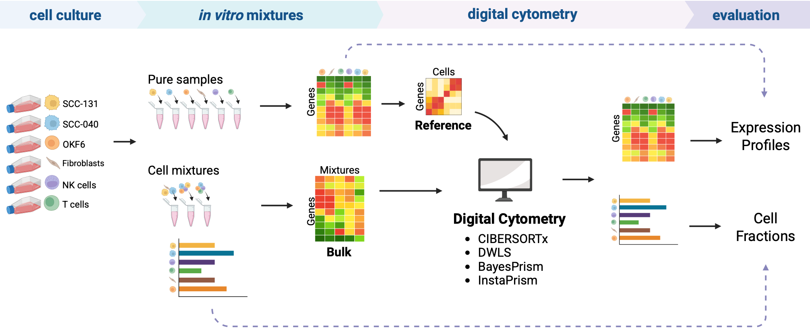

# README

## Description

Evaluation experiment of Digital Cytometry (or transcriptomic deconvolution) methods using:

-   Gene expression profiles (GEPs) of six pure cell lines as reference and ground truth:
    -   UPCI-SCC-040 (HNSCC tumor cells)
    -   UPCI-SCC-131 (HNSCC tumor cells)
    -   OKF6 (immortalized keratinocytes)
    -   Dermal primary fibroblasts
    -   Jurkat T-cells (immune cells)
    -   Natural Killer (NK-92) cells (immune cells)
-   Bulk data from our own mixtures generated *in vitro* mixtures using the six cell lines in different proportions (ground truth).

Under three use cases: 1) different abundance in the buk, 2) inaccurate cells in the reference, and 3) presence of artifacts in the reference profiles.

**Publication**: *currently under review; reference will be available once it is published*

## **Methods**

| Name | Method | Input ref\* | GEPs\*\* | Reference |
|:-----------|:--------------|---------|:--------|:---------------------------|
| **CIBERSORTx** | Regression | bulk | Yes | <https://doi.org/10.1038/s41587-019-0114-2> |
| **DWLS** | Regression | bulk | No | <https://doi.org/10.1038/s41467-019-10802-z> |
| **BayesPrism** | Bayesian | bulk / sc | Yes | <https://doi.org/10.1038/s43018-022-00356-3> |
| **InstaPrism** | Fast Implementation of BayesPrism | bulk | Yes | <https://doi.org/10.1093/bioinformatics/btae440> |
| **BLADE** | Bayesian | sc | Yes | <https://doi.org/10.1038/s41467-021-26328-2> |

\*Input ref refers to what type of input data is used as reference for each tool in our experiment. *bulk* refers to bulk RNAseq from pure profiles and *sc* refers to single-cell RNAseq.

\*\*GEPs column indicates whether the deconvolution output of a method includes estimation of gene expression profiles (GEPs) besides cell type fractions.

## Data

-   Bulk RNAseq data from *in vitro* mixtures and pure profiles is available in GEO with accession number: [GSE324026](https://www.ncbi.nlm.nih.gov/geo/query/acc.cgi?acc=GSE324026). **Mixtures composition:** see data/InVitroMixtures.tsv

-   Single-cell RNAseq data: HNSCC HPV-negative single-cell atlas by [Kroehling et al., 2026](https://www.nature.com/articles/s43856-026-01401-3). Available as a Seurat.rds object for download on [zenodo](https://zenodo.org/records/17880437).

## Code

Main functions to perform evaluation experiment:

-   **Running deconvolution**: see code/01_RunningDigitalCytometry

-   **Modifying reference profiles for Use Case 3**: see code/02_NoiseAdditionReference

-   **Output processing**: see code/03_OutputProcessing

-   **Distances between output and ground truth**: see code/04_DistancesFromGroundTruth

-   **Recovery of the biological signal**: see code/05_DownstreamAnalysis

## Authors

-   TMO, IDC, Helmholtz Munich.
